<!--
  ╔═════════════════════════════════════════════════════════════════════════╗
  ║  MODE :: AI MONARCH                                                    ║
  ║  root@steveandrew-rouse:~$ ./enter --realm neural --trace false        ║
  ║  ACCESS GRANTED // fifteen systems registered // two shipped            ║
  ╚═════════════════════════════════════════════════════════════════════════╝
-->

<div align="center">



<a href="https://github.com/steveandrew-rouse">
  
</a>

<br />


</div>



## `$ ./ignite --all`

```
┌─[ BOOT SEQUENCE // AI MONARCH ]────────────────────────────────────────────
│
│  root@monarch:~$ ./ignite --all
│
│  [ OK ] neural substrate mounted
│  [ OK ] operator verified :: steve andrew rouse
│  [ OK ] uplink encrypted / trace disabled
│  [ OK ] register loaded :: 2 shipped · 13 in development
│  [ OK ] local models online / fusion memory active
│  [ OK ] agent swarm idle / awaiting intent
│  [ !! ] curiosity level :: unbounded
│
└─ realm awake. welcome to the wired.
```

## `$ cat ./about.txt`

```bash
> whoami
Steve Andrew Rouse — student developer, product engineer, builder of intelligent systems.

> current_focus
AI & Data Science · AGI concepts · Agentic AI · Full-stack development
UI/UX design · system architecture · cloud & DevOps · psychology of interfaces

> doctrine
One operator, one stack, many surfaces. Intelligence belongs on the desk,
not only in someone else's cloud. Ship the interface and the data layer with
the same rigor — then give the human the final key.

> mission
Turn AI, automation and human-centered design into operating environments and
secure digital infrastructure with advanced visualization.

> load
[■■■■■■■■■■■■■■■■■■■■■■■■■■■■■■■■■□□□]  87% — always compiling
```


## `$ cat ./register.status`

**Legend** — `●` shipped &nbsp;·&nbsp; `◐` building &nbsp;·&nbsp; `○` research / concept

| | SYSTEM | STATE | STAGE |
| :-: | :-- | :--: | :-- |
| ● | **STARKIE OS** | `SHIPPED` | Working Electron desktop application — the first completed build |
| ● | **STARLY INDUSTRIES — SOCIAL CARD** | `SHIPPED` | Animated social card · Obsidian / ASCII / Matrix / Glitch themes |
| ◐ | **KATE.OS / KATE AI** | `ALPHA` | Phase 1 — conversational intelligence, agent workflows, memory, voice |
| ◐ | **OPERA NATION** | `PLAYABLE` | Babylon.js open world · Harborview, vehicles, missions, police, saves |
| ◐ | **INNOVARA NOTES** | `BUILDING` | Shared student bookshelf · live web/PWA + automated Android APK |
| ◐ | **REMOTE iOS SIMULATOR** | `PROTOTYPE` | Actions macOS runner → authenticated HTTPS/WebSocket stream (3–6 FPS) |
| ◐ | **SONORA — iPod PLAYER** | `PROTOTYPE` | Playback, queue, shuffle, seek, radio integration attempt |
| ◐ | **STARLY PORTFOLIO / STARLY.LIVE** | `ROLLOUT` | Public presence + custom-domain finalisation |
| ◐ | **STARLY OS 2.0** | `EARLY` | Next.js + Genkit browser OS prototype |
| ◐ | **H-5E ENERGY HARVESTER** | `DESIGN` | Wind + solar harvesting, storage, monitoring, 5V/12V targets |
| ○ | **ETN** | `CONCEPT` | Privacy-first encrypted transaction network |
| ○ | **INDIA AI OS MAPS** | `CONCEPT` | National-scale geospatial intelligence platform |
| ○ | **CICL** | `CONCEPT` | Crime intelligence & cognitive logic platform |
| ○ | **RAM 8S / 8S-Z** | `RESEARCH` | Memory controller + packet fabric architecture |
| ○ | **QUANTUM DISASTER SENSOR CHIP** | `RESEARCH` | Solar-powered quantum sensing network |

<br />

<details open>
<summary><b><code>KATE.OS</code></b> &nbsp;·&nbsp; the crown system &nbsp;·&nbsp; <code>ALPHA / PHASE 1</code></summary>

<br />

A personal AI operating environment: conversational intelligence, coding assistance, agent orchestration, memory, research and desktop integration — with local model training and reasoning experiments running underneath.

| Layer | Intent |
| :-- | :-- |
| Conversation | Natural interface, not a command line |
| Agents | Specialist workers for code, research, investigation, reporting |
| Memory | Fusion memory + RAM 8S research |
| Models | Local inference and fine-tuning experiments (SmolLM2 / LoRA) |
| Surface | Desktop environment, voice, later wearables |

**Repo** — [Kate-](https://github.com/steveandrew-rouse/Kate-) &nbsp;·&nbsp; **State** — alpha, modules beyond Phase 1 are planned

</details>

<details>
<summary><b><code>OPERA NATION</code></b> &nbsp;·&nbsp; browser-native open world &nbsp;·&nbsp; <code>PLAYABLE BUILD</code></summary>

<br />

Babylon.js + TypeScript + Vite. Harborview district, character customisation, NPCs, vehicles, an apartment, a mission, police response, world map and browser-based saving — with city expansion and deeper AI on the roadmap.

**Play** — [opera-nation](https://raisar2007steve-web.github.io/opera-nation/) &nbsp;·&nbsp; **Repo** — [opera-nation](https://github.com/steveandrew-rouse/opera-nation)

</details>

<details>
<summary><b><code>REMOTE iOS SIMULATOR</code></b> &nbsp;·&nbsp; cloud device lab &nbsp;·&nbsp; <code>PROTOTYPE</code></summary>

<br />

A GitHub Actions macOS runner boots a real iPhone Simulator, builds and launches an app, streams frames to a browser over an authenticated HTTPS/WebSocket channel and attempts remote input. Honest about its ceiling: hosted-runner capture sits around 3–6 FPS, not a 60/90 FPS streaming product.

**Repo** — [sim-ios](https://github.com/steveandrew-rouse/sim-ios)

</details>

<details>
<summary><b><code>STARLY INDUSTRIES</code></b> &nbsp;·&nbsp; identity + social card &nbsp;·&nbsp; <code>SHIPPED v1</code></summary>

<br />

A responsive, animated social-card page with four visual themes — **Obsidian**, **ASCII**, **Matrix**, **Glitch** — plus an Instagram landing path for traffic measurement.

**Live** — [starly.lives-in-the-cloud](https://starly.lives-in-the-cloud/) &nbsp;·&nbsp; **Repo** — [starlytechsocial](https://github.com/steveandrew-rouse/starlytechsocial)

</details>

<details>
<summary><b><code>INNOVARA NOTES</code></b> &nbsp;·&nbsp; shared knowledge shelf &nbsp;·&nbsp; <code>WORKING BUILD</code></summary>

<br />

A bookshelf instead of a private notebook: each student keeps a public book of ideas, projects, notes and tasks. Live web/PWA plus an automated Android APK build.

**Repo** — [notes](https://github.com/steveandrew-rouse/notes)

</details>


## `$ ./neural_stack --list`

<div align="center">


<br /><br />

**INTELLIGENCE** &nbsp;—&nbsp; agentic AI · LLM systems · RAG · prompt engineering · local models · LoRA fine-tuning · multi-agent architecture · AI memory systems · conversational intelligence


**ENGINEERING** &nbsp;—&nbsp; full-stack · desktop · web · APIs · system design · architecture · debugging


**DELIVERY** &nbsp;—&nbsp; cloud · containers · pipelines · Linux · automation · observability


**INTERFACE** &nbsp;—&nbsp; UI/UX · motion · 3D · glassmorphism · cinematic web · creative prototyping


</div>


## `$ htop --monarch`

<div align="center">


<br /><br />


<br /><br />

<a href="https://github.com/steveandrew-rouse/Kate-"></a>
<a href="https://github.com/steveandrew-rouse/opera-nation"></a>

<a href="https://github.com/steveandrew-rouse/sim-ios"></a>
<a href="https://github.com/steveandrew-rouse/starlytechsocial"></a>

<br /><br />


<br /><br />


</div>


## `$ cat ./callings.md`

```bash
> open_channels
[1] AI systems        — assistants, agent swarms, memory, local-first intelligence
[2] Product builds    — full-stack, desktop, PWA, end to end
[3] Experience        — interfaces, motion, 3D, cinematic web
[4] Collaborations    — games, research prototypes, student projects
[5] Cloud & delivery  — containers, pipelines, deployments that repeat

> accept_criteria
Real code. Clear scope. Honest status labels. No imaginary metrics.

> transmit
steveandrewrouse@gmail.com
```

<div align="center">

<a href="mailto:steveandrewrouse@gmail.com">
  
</a>
<a href="https://github.com/steveandrew-rouse?tab=repositories">
  
</a>
<a href="https://starly.lives-in-the-cloud/">
  
</a>

</div>

## `$ simulate --future`

```
┌─[ ROADMAP // SIMULATED FUTURE ]────────────────────────────────────────────
│
│  2026  ├─ KATE.OS alpha hardened → beta surface .................. active
│        ├─ Opera Nation city expansion + deeper AI ................. playable
│        ├─ Starly.live custom domain locked in ..................... rollout
│        └─ Remote simulator input latency experiments .............. prototype
│
│  2027  ├─ KATE wearable optical feasibility rig ................... concept
│        ├─ ETN privacy architecture paper .......................... research
│        └─ H-5E measured bench build ............................... design
│
│  2028  └─ INDIA AI OS MAPS pilot surface .......................... vision
│
└─ labels describe intent, not a promise. the register is the source of truth.
```

## `$ ./connect.sh`

<div align="center">

<a href="https://github.com/steveandrew-rouse">
  
</a>
<a href="https://linkedin.com/in/steverouse">
  
</a>
<a href="https://twitter.com/steverouse">
  
</a>

<br /><br />


```
┌─[ SESSION CLOSED ]─────────────────────────────────────────────────────────
│
│   ACCESS GRANTED                                            ░░░░░▒▒▒▓▓▓███
│   trace route ................................ 127.0.0.1
│   encryption ................................. AES-256
│   mode ....................................... AI MONARCH
│   mission .................................... BUILD THE FUTURE
│
└─ keep humans in control. keep systems honest. keep shipping.
```

<details>
<summary><sub><code>[ ! ] unauthorized access detected — click to contain</code></sub></summary>

<br />

```
        (\__/)   "Follow the white rabbit."
        (o.o )
        (> < )   the code was always yours to read.
```

> The Matrix is everywhere. It is the code we ship.

</details>

<sub>© 2026 Steve Andrew Rouse · built with ASCII, caffeine and a terminal</sub>

</div>
